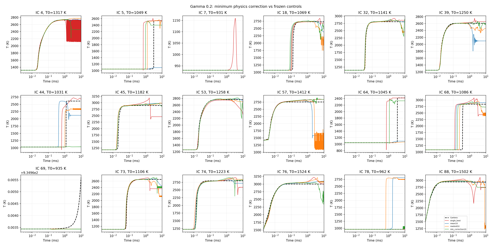
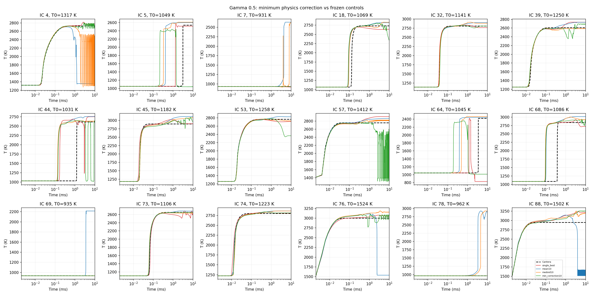
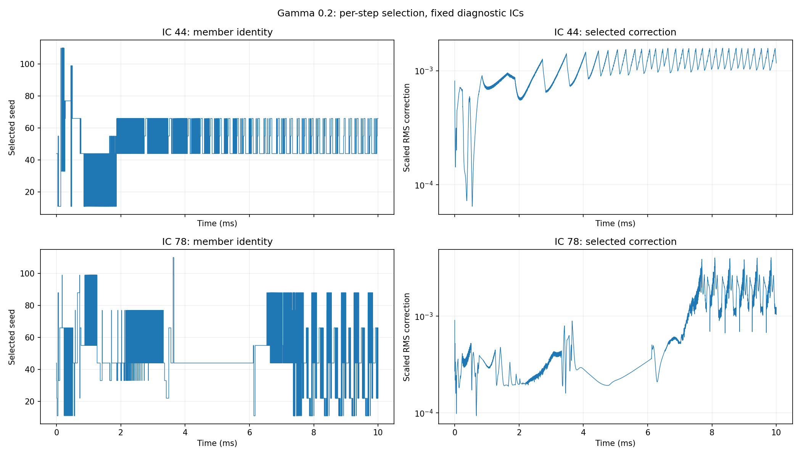
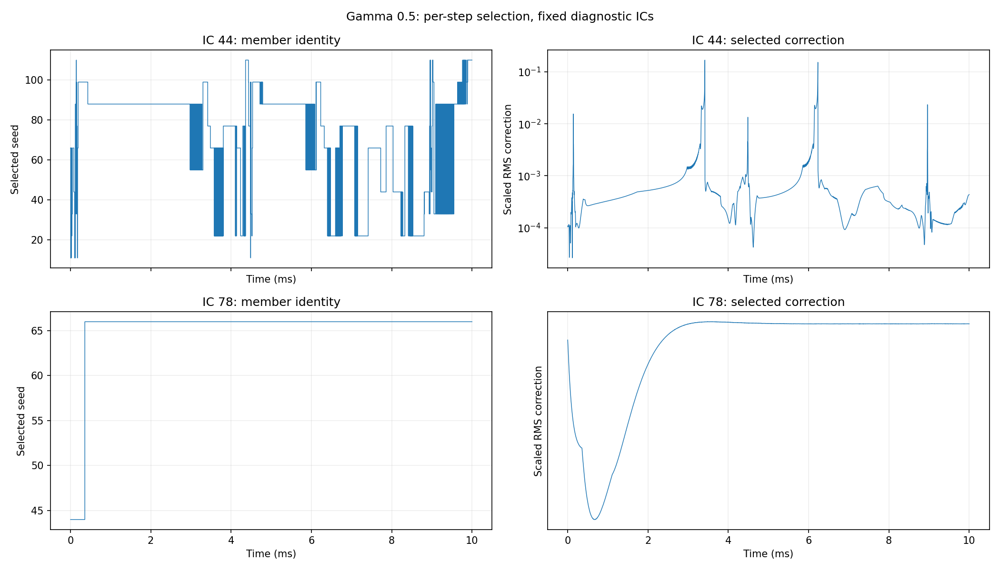

# Temperature profiles: minimum physics-correction selection

Each panel is one of the 18 held-out initial conditions. All runs use a fixed
2 μs timestep for 10 ms. The horizontal axis is logarithmic; t=0 is omitted
from display only. Models are the previously trained 64–64–64 tanh networks.

- **Green:** choose the valid member with the smallest train-scaled T/Y physics correction at every timestep.
- **Black dashed:** Cantera reference.
- **Red:** best a priori singleton within that gamma (gamma=.2 seed66; gamma=.5 seed77).
- **Blue:** mean of ten corrected candidates.
- **Orange:** medoid of ten corrected candidates.

The common singleton control in the report is gamma=.2/seed66. The gamma=.5 red
curve is its own per-gamma auxiliary singleton, not the common control.

## Gamma = 0.2: all 18 test profiles

[Open full-resolution image](results/min_correction_tanh10/figures/g0.2_temperature.png)

## Gamma = 0.5: all 18 test profiles

[Open full-resolution image](results/min_correction_tanh10/figures/g0.5_temperature.png)

## Per-step selection diagnostics

### Gamma = 0.2

### Gamma = 0.5

## Reports and raw results

- [Minimum-correction selection report](MIN_CORRECTION_REPORT.md)
- [Original gamma=.2/.5 training and mean/medoid report](PREPROCESS_REPORT.md)
- [Comparison summary CSV](results/min_correction_tanh10/comparison_summary.csv)
- [Per-initial-condition results](results/min_correction_tanh10/trajectories.csv)
- [Selection verification](results/min_correction_tanh10/verification.json)

The saved raw traces contain 18 × 5,001 × 10 values per gamma and split.
Recomputing the test mean temperature-profile RMSE from the traces gives
266.0517507348 K for gamma=.2 and 328.5009245241 K for gamma=.5.
