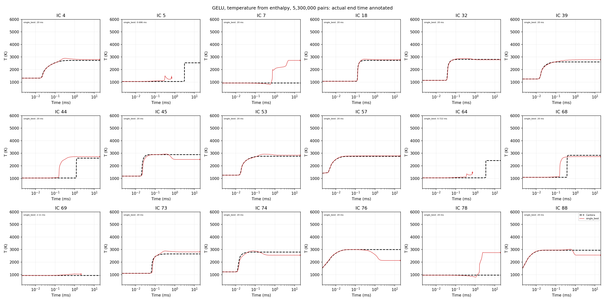

# 530만 쌍 GELU NN: 엔탈피 기반 온도 복원

학습 데이터 **5,300,000쌍**, epoch **10회**, 모델 **1개**, gamma=0.1. 구조는 [11, 1600, 800, 400, 11].

입력은 train Z-score(T, linear P, literal BCT(Y)), 출력은 별도 train Z-score의 Δ(T,P,BCT(Y))다. NN의 온도 출력을 버리고, 현재 엔탈피와 갱신된 조성으로 다음 온도를 복원한다. 열역학 물성 계산에만 Cantera의 정규화 조성 정의를 사용하고, 저장·self-feed하는 ANN 조성은 변경하지 않는다. 원소 보정·decoder clipping·출력 질량합 재정규화는 없다. 온도 해가 200–6000 K에 없으면 실패로 기록한다.

## 최종 해석 시간: 10 ms / 20 ms

수치 완주와 물리 허용 완주를 구분한다. 도중 실패한 궤적의 full-profile 오차는 NaN으로 제외하며 실제 도달 시간과 coverage를 함께 표시한다. 숫자가 유한하다는 사실만으로 안정적인 kinetics 예측이라고 판단하지 않는다.

### Test 10 ms

| method | completed | physical_completed | coverage_% | median_end_ms | ignition_classification | ignition_pairs | temperature_profile_mean | species_profile_mean |
|---|---|---|---|---|---|---|---|---|
| single_best | 15 | 1 | 85.289 | 10 | 0.83333 | 15 | 425.76 | 0.033379 |

### Test 20 ms

| method | completed | physical_completed | coverage_% | median_end_ms | ignition_classification | ignition_pairs | temperature_profile_mean | species_profile_mean |
|---|---|---|---|---|---|---|---|---|
| single_best | 15 | 1 | 84.311 | 20 | 0.83333 | 15 | 429.22 | 0.033499 |

## 단일 모델 선택

Validation one-step 90,000쌍으로 seed 11를 고정했다. 선택 후보 풀은 1개이며 usable validation model=True이다. Test/rollout 결과로 선택을 바꾸지 않았다. 후보가 하나면 다른 모델 중 최상위를 골랐다는 뜻이 아니다.

| seed | rmse | major_rmse | minor_rmse | relative_log_mean | relative_p50 | relative_p95 | invalid_row_fraction | negative_fraction | negative_row_fraction | mass_sum_mae | mass_sum_max | elemental_mae | elemental_max | temperature_rmse | selection_score |
|---|---|---|---|---|---|---|---|---|---|---|---|---|---|---|---|
| 11 | 0.00049456 | 0.00066527 | 1.035e-05 | 0.022885 | 0.0043574 | 0.088014 | 0 | 0 | 0 | 0.0010115 | 0.01361 | 0.00091966 | 0.013175 | 4.2116 | 0.039652 |

## One-step test

| method | split | rmse | major_rmse | minor_rmse | relative_log_mean | relative_p50 | relative_p95 | invalid_row_fraction | negative_fraction | negative_row_fraction | mass_sum_mae | mass_sum_max | elemental_mae | elemental_max | temperature_rmse | selection_score |
|---|---|---|---|---|---|---|---|---|---|---|---|---|---|---|---|---|
| single_best | test | 0.00057016 | 0.00079253 | 9.8405e-06 | 0.033237 | 0.0061275 | 0.28907 | 0 | 0 | 0 | 0.0012421 | 0.017475 | 0.0011406 | 0.015464 | 4.2201 | 0.053583 |

## 후기 구간과 실패

| method | early_count | early_T_RMSE | late_count | late_T_RMSE | tail_count | tail_T_RMSE |
|---|---|---|---|---|---|---|
| single_best | 16 | 327.32 | 15 | 413.07 | 15 | 421.74 |

각 구간 전체를 끝낸 경우에만 RMSE를 정의한다. 구간에 도달하지 못한 결과를 작은 오차로 해석하지 않는다.

| method | status | ICs |
|---|---|---|
| single_best | completed | 15 |
| single_best | numeric_magnitude_guard | 2 |
| single_best | undefined_BCT_inverse_or_nonfinite | 1 |

## 그래프

검정 점선은 Cantera, 나머지는 NN 방법별 결과다. 각 패널은 실제 숫자로 전진한 마지막 시간을 표시한다. t=0은 로그축 표시에서만 제외했고, y축 200–6000 K 제한은 원자료를 clipping한 것이 아니다.

## 범위와 한계

데이터는 Zhang §2.5의 독립 log sampling 규칙을 사용한다. 다만 기존 비교를 위한 9종/28반응, dt=2 μs, P=.5–5 atm 확장과 명시적인 N2-preserving 정규화 가정은 유지했다. 전체 표본 수를 논문 규모로 맞춘 것과 논문의 모든 구현/학습 조건을 재현했다는 주장은 다르다. GELU 1600/800/400은 저장소의 기존 논문 모델 설정을 따른다.

이전 8,834쌍 pilot과는 데이터 규모뿐 아니라 네트워크 크기 및 학습량도 달라졌다. 그 비교로 데이터 크기만의 인과 효과를 주장하지 않는다. 이번 실험은 온도만 엔탈피로 복원하며, Wang식 원소 보존 projection은 사용하지 않는다.

- [원시 IC별 결과](results/zhang_5p3m_gelu/g0.1/evaluation_enthalpy_seeds11/trajectories.csv)
- [입출력/선택 프로토콜](results/zhang_5p3m_gelu/g0.1/evaluation_enthalpy_seeds11/protocol.json)
- [모델/epoch/검증 기록](results/zhang_5p3m_gelu/g0.1/evaluation_enthalpy_seeds11/manifest.json)

