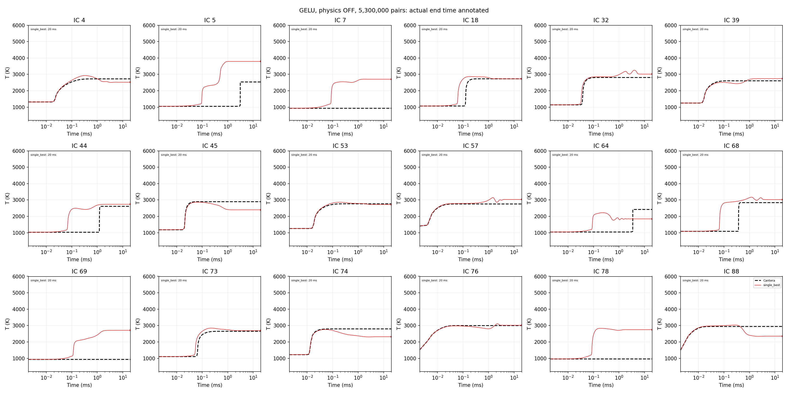

# 530만 쌍 GELU NN: physics OFF

학습 데이터 **5,300,000쌍**, epoch **10회**, 모델 **1개**, gamma=0.1. 구조는 [11, 1600, 800, 400, 11].

입력은 train Z-score(T, linear P, literal BCT(Y)), 출력은 별도 train Z-score의 Δ(T,P,BCT(Y))다. NN의 온도·압력도 그대로 self-feed한다. 원소 보정·엔탈피 복원·decoder clipping·질량합 재정규화는 없다.

## 최종 해석 시간: 10 ms / 20 ms

수치 완주와 물리 허용 완주를 구분한다. 도중 실패한 궤적의 full-profile 오차는 NaN으로 제외하며 실제 도달 시간과 coverage를 함께 표시한다. 숫자가 유한하다는 사실만으로 안정적인 kinetics 예측이라고 판단하지 않는다.

2026년 10월 30일 16:05 KST에 학습·평가가 완료됐다. CPU 4개 thread에서
학습 시간은 46.3분, update는 103,520회, 누적 학습 표본은 53,000,000개다.
이번 결과는 gamma=.1 seed11 **단일 모델**이며, 10개 앙상블 결과가 아니다.

온도 profile RMSE는 시간 적분으로 구한 각 IC의 RMSE(K)를 평균한 값이다.
물리 허용 기준은 모든 시점에서 종 질량분율이 [0,1] 범위(수치 허용오차
1e-12), 온도가 200–6000 K, 질량합 및 원소 질량분율의 초기값 대비 오차가
0.01 이하, 압력 변화가 초기값의 1% 이하인 경우다. Test의 최대 질량합
오차는 0.2475, 최대 원소 보존 오차는 0.2281로, 기준을 크게 초과했다.

### Test 10 ms

| method | completed | physical_completed | coverage_% | median_end_ms | ignition_classification | ignition_pairs | temperature_profile_mean | species_profile_mean |
|---|---|---|---|---|---|---|---|---|
| single_best | 18 | 0 | 100 | 10 | 0.83333 | 15 | 624.51 | 0.048747 |

### Test 20 ms

| method | completed | physical_completed | coverage_% | median_end_ms | ignition_classification | ignition_pairs | temperature_profile_mean | species_profile_mean |
|---|---|---|---|---|---|---|---|---|
| single_best | 18 | 0 | 100 | 20 | 0.83333 | 15 | 596.34 | 0.049255 |

## 단일 모델 선택

Validation one-step 90,000쌍으로 seed 11를 고정했다. 선택 후보 풀은 1개이며 usable validation model=True이다. Test/rollout 결과로 선택을 바꾸지 않았다. 후보가 하나면 다른 모델 중 최상위를 골랐다는 뜻이 아니다.

| seed | rmse | major_rmse | minor_rmse | relative_log_mean | relative_p50 | relative_p95 | invalid_row_fraction | negative_fraction | negative_row_fraction | mass_sum_mae | mass_sum_max | elemental_mae | elemental_max | temperature_rmse | selection_score |
|---|---|---|---|---|---|---|---|---|---|---|---|---|---|---|---|
| 11 | 0.00049456 | 0.00066527 | 1.035e-05 | 0.022885 | 0.0043574 | 0.088014 | 0 | 0 | 0 | 0.0010115 | 0.01361 | 0.00091966 | 0.013175 | 0.98282 | 0.039652 |

## One-step test

| method | split | rmse | major_rmse | minor_rmse | relative_log_mean | relative_p50 | relative_p95 | invalid_row_fraction | negative_fraction | negative_row_fraction | mass_sum_mae | mass_sum_max | elemental_mae | elemental_max | temperature_rmse | selection_score |
|---|---|---|---|---|---|---|---|---|---|---|---|---|---|---|---|---|
| single_best | test | 0.00057016 | 0.00079253 | 9.8405e-06 | 0.033237 | 0.0061275 | 0.28907 | 0 | 0 | 0 | 0.0012421 | 0.017475 | 0.0011406 | 0.015464 | 0.97672 | 0.053583 |

## 후기 구간과 실패

| method | early_count | early_T_RMSE | late_count | late_T_RMSE | tail_count | tail_T_RMSE |
|---|---|---|---|---|---|---|
| single_best | 18 | 700.8 | 18 | 577.07 | 18 | 553.66 |

각 구간 전체를 끝낸 경우에만 RMSE를 정의한다. 구간에 도달하지 못한 결과를 작은 오차로 해석하지 않는다.

| method | status | ICs |
|---|---|---|
| single_best | completed | 18 |

## 그래프

검정 점선은 Cantera, 나머지는 raw NN 방법별 결과다. 각 패널은 실제 숫자로 전진한 마지막 시간을 표시한다. t=0은 로그축 표시에서만 제외했고, y축 200–6000 K 제한은 원자료를 clipping한 것이 아니다.

## 범위와 한계

데이터는 Zhang §2.5의 독립 log sampling 규칙을 사용한다. 다만 기존 비교를 위한 9종/28반응, dt=2 μs, P=.5–5 atm 확장과 명시적인 N2-preserving 정규화 가정은 유지했다. 전체 표본 수를 논문 규모로 맞춘 것과 논문의 모든 구현/학습 조건을 재현했다는 주장은 다르다. GELU 1600/800/400은 저장소의 기존 논문 모델 설정을 따른다.

이전 8,834쌍 pilot과는 데이터 규모뿐 아니라 네트워크 크기 및 학습량도 달라졌다. 그 비교로 데이터 크기만의 인과 효과를 주장하지 않는다. Physics-off는 사용자 요청이며, 원문에서 온도를 엔탈피로 복원하는 부분과 의도적으로 다르다.

- [원시 IC별 결과](results/zhang_5p3m_gelu/g0.1/evaluation_seeds11/trajectories.csv)
- [입출력/선택 프로토콜](results/zhang_5p3m_gelu/g0.1/evaluation_seeds11/protocol.json)
- [모델/epoch/검증 기록](results/zhang_5p3m_gelu/g0.1/evaluation_seeds11/manifest.json)

