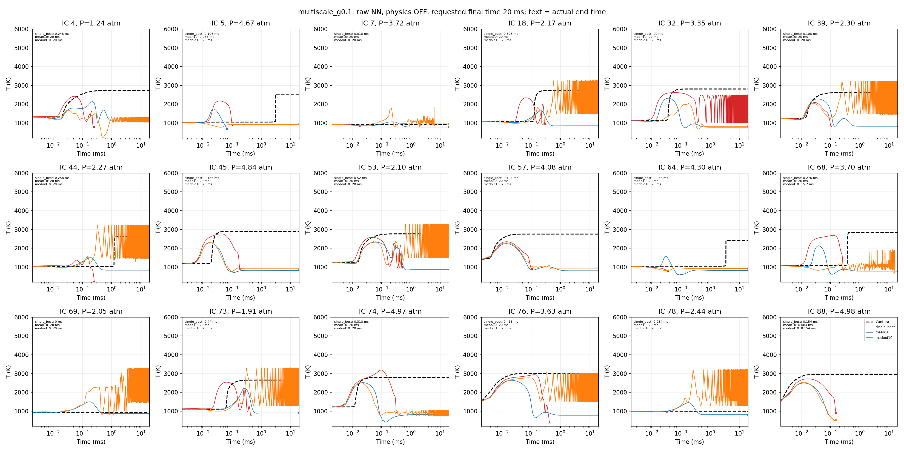
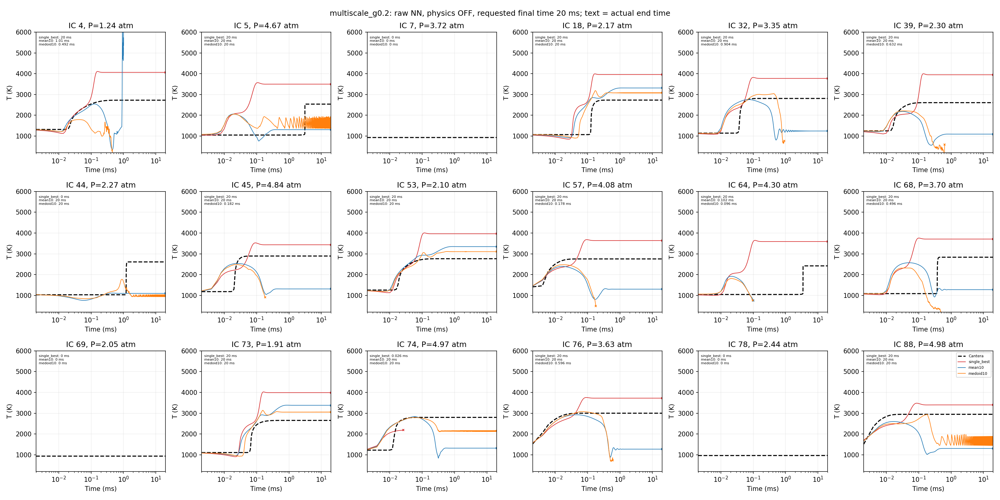
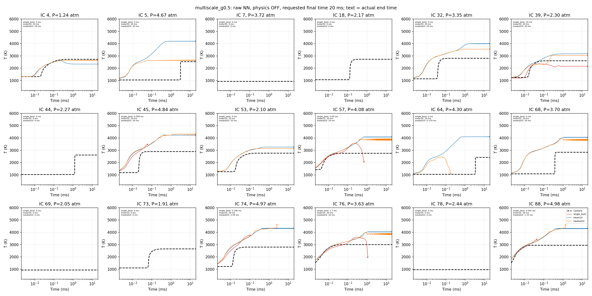
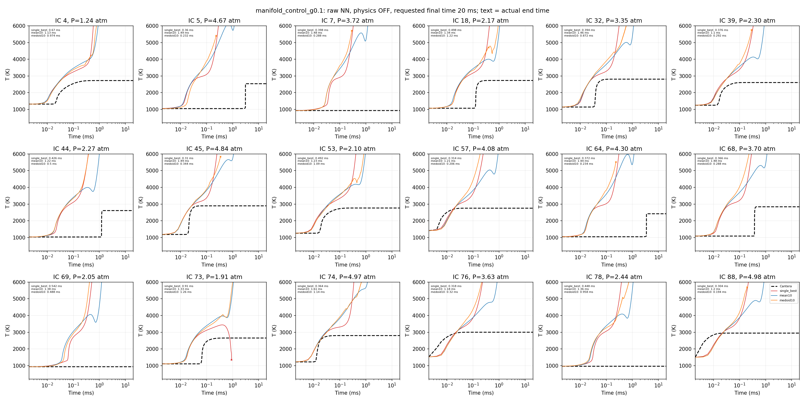
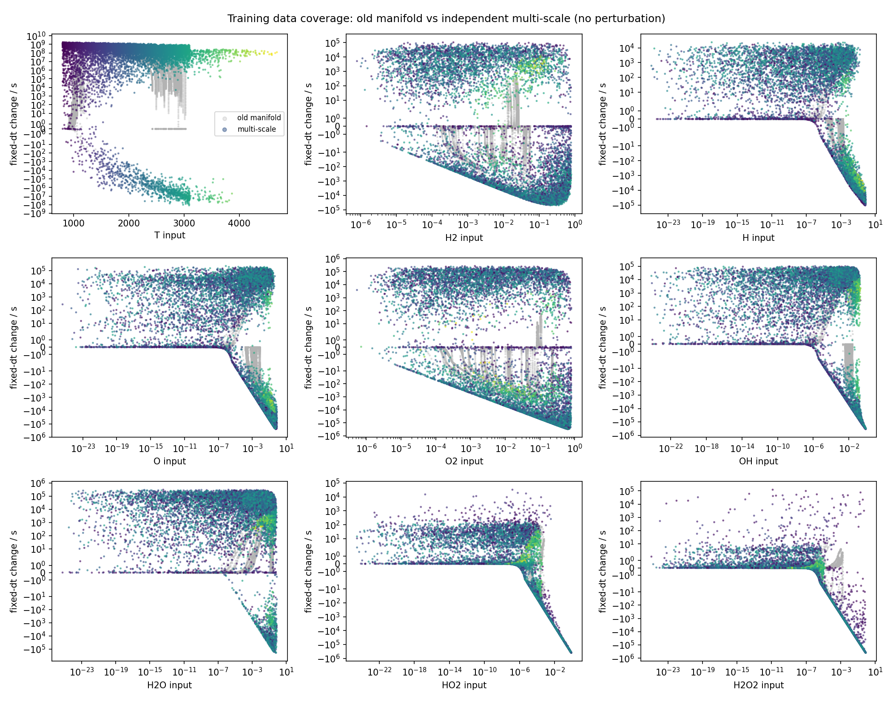
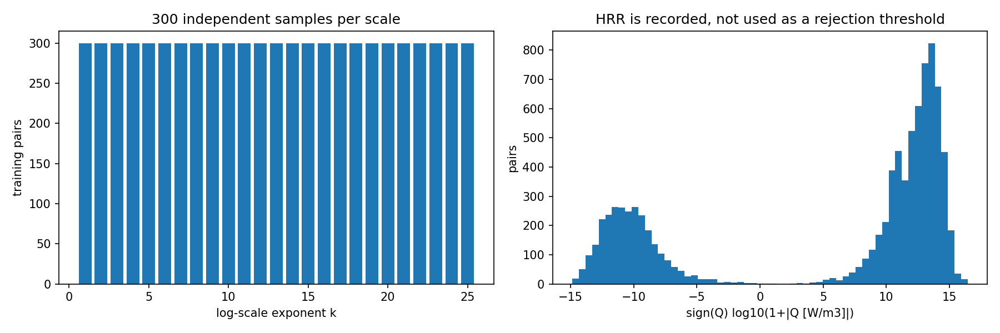

# Zhang multi-scale sampling: raw NN, physics OFF

**All methods have 0/18 physically admissible test completions.** Some raw NN
trajectories stay numerically finite for 20 ms while violating mass/element
conservation. These figures show the failed experiment; they do not establish
accurate long-time chemistry.

The 40 newly trained models use 64–64–64 tanh, with 11 inputs and 11 increment
outputs. Inputs are T, linear P, and Box–Cox(Y); temperature and pressure are
self-fed from the raw NN. There is no physics correction, decoder clipping,
enthalpy closure, or mass renormalization.

Each figure has all 18 test initial conditions. Black dashed = Cantera;
red = validation a priori best singleton; blue = mean10; orange = medoid10.
The text in each panel is the **actual numerical end time**. A curve that stops
before 20 ms failed before the requested final time. A first-step failure has
no NN curve and is labeled 0 ms. The logarithmic time axis omits t=0 only;
the plotting range 200–6000 K does not alter the saved raw trajectories.

## Multi-scale sampling, gamma = 0.1

[Full-resolution image](results/zhang_multiscale_raw/figures/multiscale_g0.1_temperature20ms.png)

## Multi-scale sampling, gamma = 0.2

[Full-resolution image](results/zhang_multiscale_raw/figures/multiscale_g0.2_temperature20ms.png)

## Multi-scale sampling, gamma = 0.5

[Full-resolution image](results/zhang_multiscale_raw/figures/multiscale_g0.5_temperature20ms.png)

## Matched manifold control, gamma = 0.1

This control uses the old 8,815 training pairs with exactly the same new raw
input/output, L1 loss, seeds, architecture, update count, and physics-off rule.
Only the sampling data differ from the gamma=.1 multi-scale arm.

## Training-data coverage

The multi-scale arm has 8,834 pairs, not the paper's 5.3 million. Pressure is
extended to 0.5–5 atm to match the existing test domain. The N2-preserving
normalization is an explicit implementation assumption; details are in the report.

## Report and numerical evidence

- [Full report: 10/20-ms results, early/late errors, failures and paper differences](ZHANG_MULTISCALE_RAW_REPORT.md)
- [Summary with actual end times](results/zhang_multiscale_raw/summary_with_coverage.csv)
- [Per-initial-condition results](results/zhang_multiscale_raw/trajectories.csv)
- [Raw model protocol](results/zhang_multiscale_raw/protocol.json)
- [Verification](results/zhang_multiscale_raw/verification.json)
- [Pytest log](results/zhang_multiscale_raw/pytest.log)
